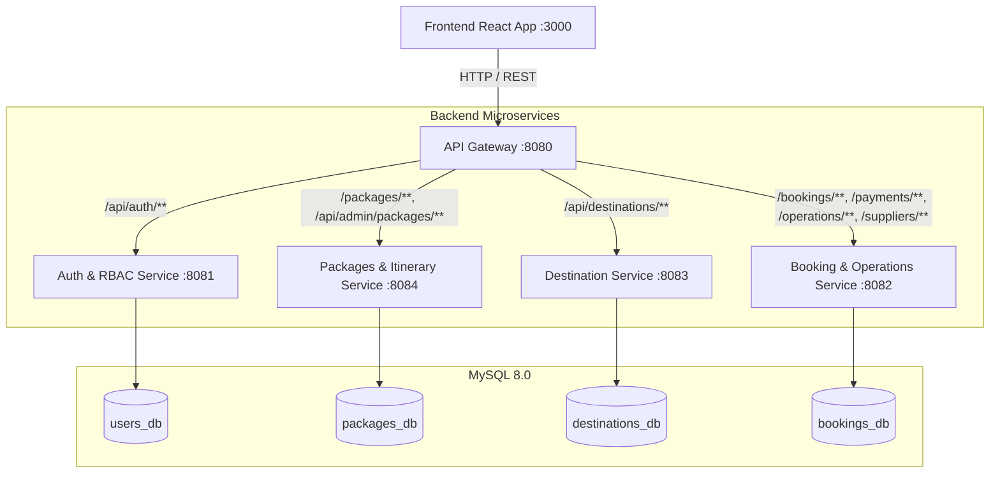
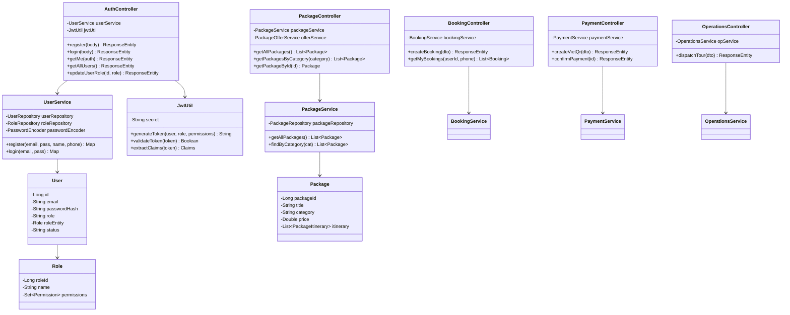
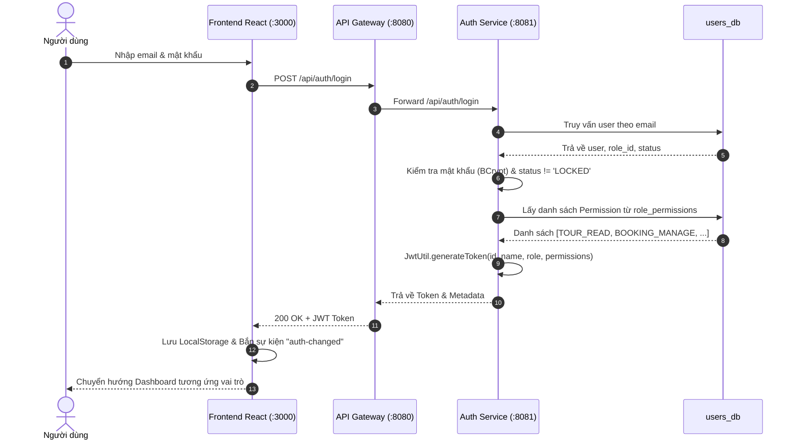
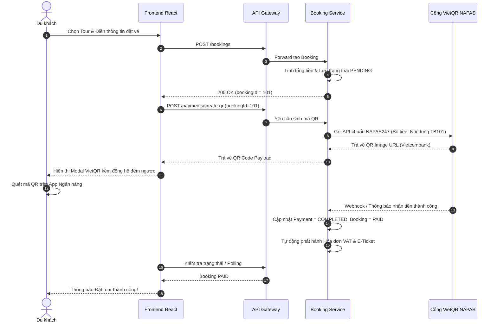
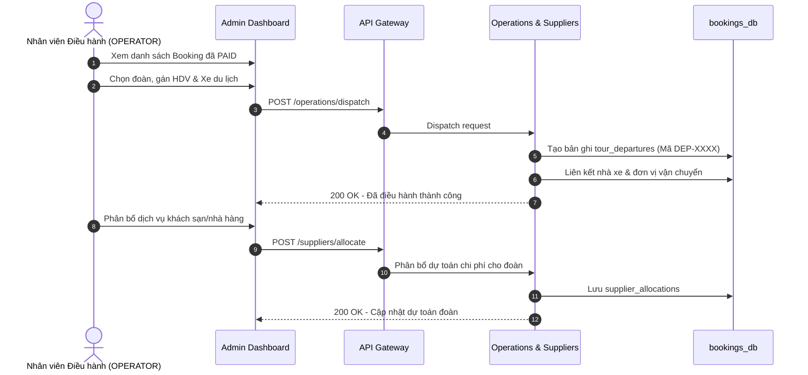

# TÀI LIỆU THIẾT KẾ CHI TIẾT BACKEND (BACKEND DESIGN DOCUMENT)
**Hệ thống Quản lý và Điều hành Tour Du lịch TravelBook**
**Công nghệ:** Java 17 | Spring Boot 3.2.0 | Spring Cloud Gateway | Spring Data JPA | Spring Security & JJWT

---

## 1. TỔNG QUAN KIẾN TRÚC BACKEND & ĐIỀU HƯỚNG GATEWAY

Backend của TravelBook được xây dựng theo kiến trúc **Microservices** hướng dịch vụ, độc lập triển khai và dễ dàng mở rộng. Mọi yêu cầu từ máy trạm (Frontend / Mobile App) đều đi qua **API Gateway** làm điểm vào duy nhất (Single Point of Entry).



### 1.1. Bảng phân bổ cổng & Định tuyến Gateway (`application.yml`)
| Microservice | Cổng nội bộ | Tiền tố Route tiếp nhận tại Gateway | Nhiệm vụ chính |
| :--- | :--- | :--- | :--- |
| **api-gateway** | `8080` | `http://localhost:8080` | Cổng gom luồng, kiểm tra CORS toàn cục, dedupe headers |
| **auth-service**| `8081` | `/api/auth/**` | Đăng ký, đăng nhập JWT, quản lý tài khoản & ma trận quyền RBAC |
| **destination-service**| `8083` | `/api/destinations/**`, `/api/admin/destinations/**` | Khám phá điểm đến, bản đồ du lịch |
| **packages-service**| `8084` | `/packages/**`, `/api/admin/packages/**` | Catalog 7 danh mục tour, lịch trình theo ngày, ưu đãi |
| **booking-service**| `8082` | `/bookings/**`, `/payments/**`, `/invoices/**`, `/operations/**`, `/suppliers/**` | Đặt tour, sinh mã VietQR, điều hành đoàn, nhà cung ứng |

---

## 2. THIẾT KẾ CHI TIẾT CÁC RESTFUL API (API SPECIFICATION)

### 2.1. Phân hệ 1: Xác thực & Phân quyền người dùng (Auth & RBAC)

#### `POST /api/auth/register`
* **Mô tả:** Đăng ký tài khoản người dùng mới (vai trò mặc định `CUSTOMER`).
* **Request Body:**
  ```json
  {
    "email": "customer@travelbook.com",
    "password": "customer123",
    "name": "Nguyễn Văn An",
    "phone": "0988123456"
  }
  ```
* **Response (200 OK):**
  ```json
  {
    "token": "eyJhbGciOiJIUzI1NiJ9...",
    "userId": 5,
    "name": "Nguyễn Văn An",
    "email": "customer@travelbook.com",
    "role": "CUSTOMER",
    "permissions": ["TOUR_READ", "BOOKING_VIEW"]
  }
  ```

#### `POST /api/auth/login`
* **Mô tả:** Đăng nhập xác thực và trả về JWT mang theo danh sách quyền hạn (Permissions Claim).
* **Request Body:**
  ```json
  { "email": "operator@travelbook.com", "password": "operator123" }
  ```
* **Response (200 OK):** Trả về JWT Token cùng Role và Permissions.

#### `GET /api/auth/me`
* **Headers:** `Authorization: Bearer <token>`
* **Mô tả:** Lấy thông tin tài khoản đang đăng nhập từ JWT.

#### `GET /api/auth/users` | `PUT /api/auth/users/{id}/role` | `PATCH /api/auth/users/{id}/status`
* **Yêu cầu quyền:** `ROLE_ADMIN` hoặc `USER_MANAGE`.
* **Mô tả:** Liệt kê danh sách tài khoản; thay đổi vai trò (ADMIN, OPERATOR, SALES, GUIDE, CUSTOMER); khóa hoặc mở khóa tài khoản (`ACTIVE` / `LOCKED`).

#### `GET /api/auth/roles` | `PUT /api/auth/roles/{id}/permissions` | `GET /api/auth/permissions`
* **Yêu cầu quyền:** `ROLE_MANAGE`.
* **Mô tả:** Tải ma trận phân quyền và cập nhật quyền hạn động cho từng vai trò trong hệ thống.

---

### 2.2. Phân hệ 2: Quản lý Tour & Lịch trình lõi (Packages Service)

#### `GET /packages`
* **Mô tả:** Lấy toàn bộ danh sách gói tour du lịch hiện có trong hệ thống.
* **Response (200 OK):** Mảng các đối tượng Package kèm theo danh sách `itinerary` chi tiết.

#### `GET /packages/category/{category}`
* **Mô tả:** Lấy danh sách tour được phân loại theo 1 trong **7 chuyên mục**:
  1. `Nature & Adventure`
  2. `Cultural & Historical`
  3. `Beaches & Relaxation`
  4. `Wildlife & Safari`
  5. `Spiritual & Wellness`
  6. `Luxury & Honeymoon`
  7. `Food & Culinary`
* **Response (200 OK):**
  ```json
  [
    {
      "packageId": 7,
      "title": "Tour Khám Phá Vườn Quốc Gia Cát Tiên - Safari Đêm 2N1Đ",
      "category": "Wildlife & Safari",
      "duration": "2 days",
      "price": 135.0,
      "peopleCount": 12,
      "imageUrl": "https://images.unsplash.com/photo-1534567153574-2b12153a87f0...",
      "itinerary": [
        { "itineraryId": 20, "dayNumber": 1, "description": "Khởi hành từ TP.HCM đi Cát Tiên..." },
        { "itineraryId": 21, "dayNumber": 2, "description": "Trekking xuyên rừng nhiệt đới đến Bàu Sấu..." }
      ]
    }
  ]
  ```

#### `GET /packages/{id}` | `GET /packages/{id}/itinerary` | `GET /packages/offers`
* **Mô tả:** Lấy chi tiết gói tour theo ID, lịch trình chi tiết và danh sách banner khuyến mãi đang chạy.

#### `POST /api/admin/packages` | `PUT /api/admin/packages/{id}` | `DELETE /api/admin/packages/{id}`
* **Yêu cầu quyền:** `ROLE_ADMIN`, `ROLE_OPERATOR` hoặc `TOUR_WRITE`.
* **Mô tả:** Thêm mới, cập nhật thông tin tour hoặc xóa gói tour du lịch khỏi hệ sinh thái.

---

### 2.3. Phân hệ 3: Điểm đến du lịch (Destination Service)

#### `GET /api/destinations` | `GET /api/destinations/{id}`
* **Mô tả:** Tải danh bạ thắng cảnh, thông tin kinh độ/vĩ độ GPS phục vụ tích hợp bản đồ.

#### `POST /api/admin/destinations` | `PUT /api/admin/destinations/{id}`
* **Yêu cầu quyền:** `ROLE_ADMIN`, `ROLE_OPERATOR` hoặc `TOUR_WRITE`.

---

### 2.4. Phân hệ 4: Đặt tour, Thanh toán VietQR & Hóa đơn VAT (Booking Service)

#### `POST /bookings`
* **Mô tả:** Tiếp nhận yêu cầu đặt tour (áp dụng cho cả thành viên đăng nhập và khách vãng lai).
* **Request Body:**
  ```json
  {
    "userId": 5,
    "packageId": 7,
    "contactName": "Nguyễn Văn An",
    "contactEmail": "customer@travelbook.com",
    "contactPhone": "0988123456",
    "travelDate": "2026-11-15",
    "numPeople": 2,
    "totalPrice": 270.0,
    "specialRequests": "Đoàn có 1 người ăn chay"
  }
  ```
* **Response (200 OK):**
  ```json
  {
    "bookingId": 101,
    "status": "PENDING",
    "totalPrice": 270.0,
    "createdAt": "2026-10-26T19:00:00"
  }
  ```

#### `POST /payments/create-qr`
* **Mô tả:** Sinh mã VietQR chuyển khoản động chuẩn Vietcombank NAPAS247.
* **Request Body:**
  ```json
  {
    "bookingId": 101,
    "amount": 270.0,
    "bankCode": "970436",
    "accountNumber": "1035541655",
    "accountName": "TRAVELBOOK TOURISM JSC"
  }
  ```
* **Response (200 OK):**
  ```json
  {
    "paymentId": 201,
    "bookingId": 101,
    "amount": 270.0,
    "qrCodeUrl": "https://img.vietqr.io/image/970436-1035541655-compact2.png?amount=6750000&addInfo=TB101+0988123456",
    "status": "PENDING"
  }
  ```

#### `POST /payments/{id}/confirm`
* **Mô tả:** Xác nhận giao dịch thành công (qua Webhook hoặc Admin xác nhận), tự động cập nhật trạng thái Booking sang `PAID`.

#### `POST /invoices/generate/{bookingId}`
* **Mô tả:** Lập hóa đơn VAT điện tử (thuế suất 10%) và phát hành e-ticket gửi cho khách hàng.

---

### 2.5. Phân hệ 5: Điều hành Tour & Nhà cung ứng (Operations & Suppliers)

#### `POST /operations/dispatch`
* **Mô tả:** Điều hành tour, phân công Hướng dẫn viên, xe du lịch và tài xế cho đoàn.
* **Request Body:**
  ```json
  {
    "bookingId": 101,
    "guideName": "Trần Quốc Toản",
    "guidePhone": "0912345678",
    "driverName": "Lê Văn Lái",
    "vehicleNumber": "29B-123.45",
    "departureDate": "2026-11-15"
  }
  ```

#### `GET /suppliers` | `POST /suppliers` | `POST /suppliers/allocate`
* **Mô tả:** Quản lý danh bạ đối tác cung ứng (Khách sạn, Nhà hàng, Nhà xe) và phân bổ dịch vụ cho đoàn khởi hành.

---

## 3. THIẾT KẾ COMPONENT & CLASS (COMPONENT & CLASS DESIGN)

Hệ thống tuân thủ mô hình phân tầng chuẩn của Spring Boot: **Controller Layer** $\rightarrow$ **Service Layer** $\rightarrow$ **Repository Layer** $\rightarrow$ **Entity Layer**, đi kèm tầng **Security & DTO**.



---

## 4. THIẾT KẾ PROCESSING FLOW (LUỒNG XỬ LÝ NGHIỆP VỤ)

### 4.1. Luồng Xác thực & Ủy quyền RBAC (Authentication & RBAC Flow)



### 4.2. Luồng Đặt Tour & Thanh toán VietQR Động (Booking & Payment Flow)



### 4.3. Luồng Điều hành Đoàn & Phân bổ Nhà cung ứng (Tour Dispatch Flow)



---

## 5. THIẾT LẬP BẢO MẬT & TÍCH HỢP BÊN THỨ 3

1. **Cơ chế Stateless JWT & RBAC Filter:**
   * Secret Key: Chia sẻ mã hóa an toàn giữa các dịch vụ.
   * `JwtAuthenticationFilter`: Tự động bóc tách Claims (`userId`, `role`, `permissions`) để gán vào `SecurityContextHolder` trước mỗi request.
   * Phân quyền mức Method: Sử dụng `.hasAnyRole("ADMIN", "OPERATOR", "SALES")` hoặc Custom Annotations kiểm tra Permission.
2. **Cấu hình CORS Đa Nguồn (Dual-Origin Resilience):**
   * Cho phép đồng thời `http://localhost:3000` và `http://localhost:3001` với các HTTP Methods `GET, POST, PUT, PATCH, DELETE, OPTIONS`.
   * Bộ lọc `DedupeResponseHeader` tại Gateway loại bỏ header trùng lặp, giải quyết triệt để lỗi preflight request trên trình duyệt.
3. **Tích hợp Bản đồ & Vị trí (Google Maps API):**
   * `Destination Service` cung cấp tọa độ `latitude` và `longitude` chuẩn WGS84, sẵn sàng nhúng bản đồ Google Maps và dẫn đường cho du khách.
4. **Tích hợp Thanh toán VietQR & Cổng Ngân hàng:**
   * Chuẩn hóa mã QR theo định dạng EMVCo VietQR của NAPAS247, tự động nhúng mã số booking và số điện thoại vào nội dung chuyển khoản giúp đối soát tự động 100%.
