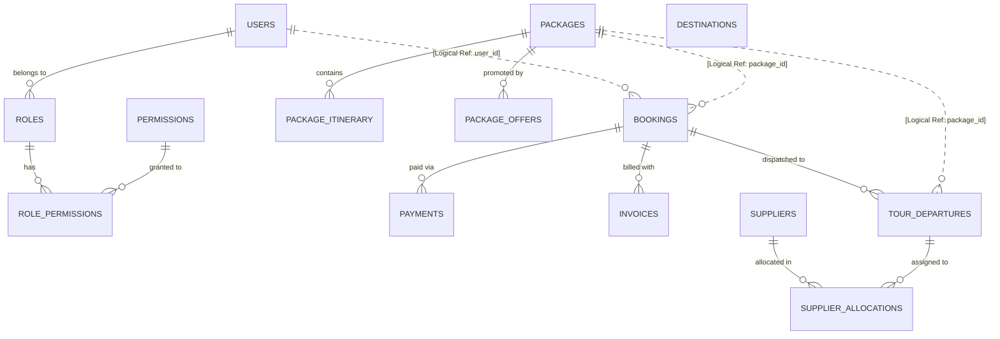
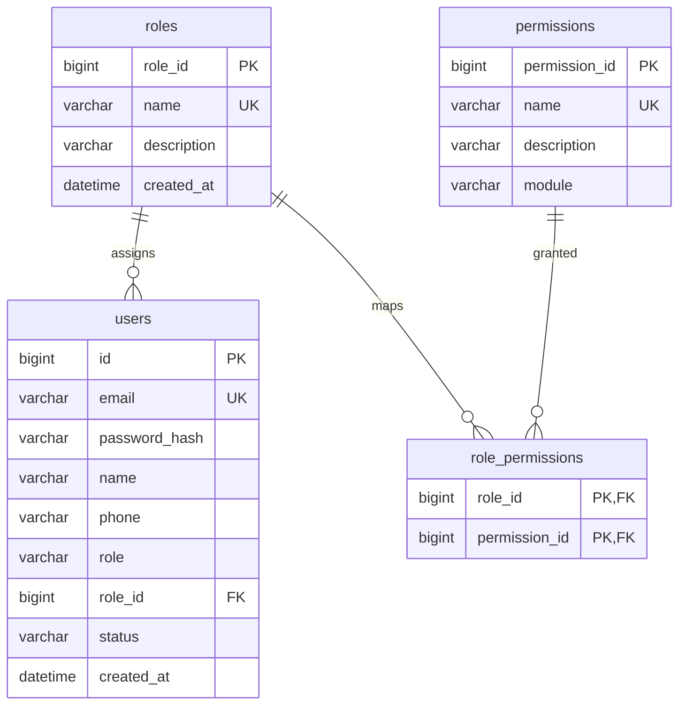
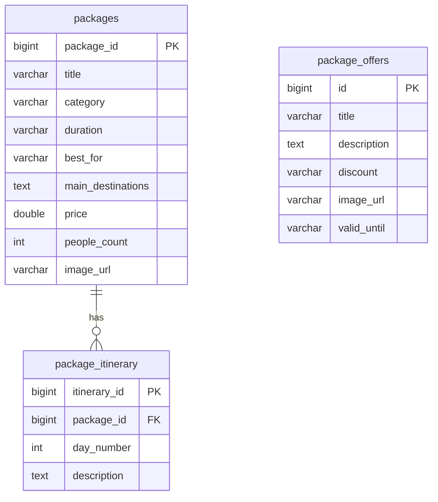
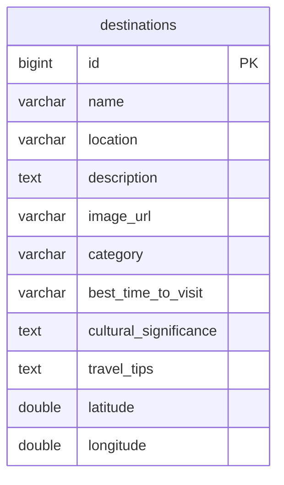
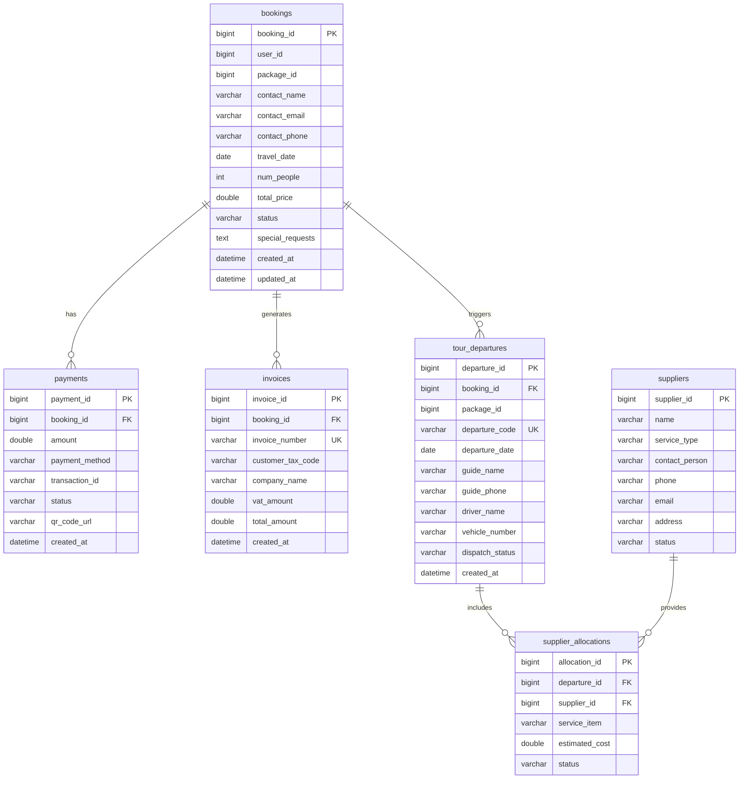

# TÀI LIỆU THIẾT KẾ CHI TIẾT CƠ SỞ DỮ LIỆU (DATABASE DESIGN DOCUMENT)
**Hệ thống Quản lý và Điều hành Tour Du lịch TravelBook**
**Kiến trúc:** Database-per-Service (Microservices Architecture)
**Hệ quản trị CSDL:** MySQL 8.0 | **Công cụ Migration:** Flyway Community Edition

---

## 1. TỔNG QUAN KIẾN TRÚC DỮ LIỆU

Hệ thống TravelBook áp dụng mô hình phân tách dữ liệu theo từng microservice (**Database-per-Service Pattern**) nhằm đảm bảo tính độc lập, an toàn và khả năng mở rộng quy mô. Mỗi microservice sở hữu một cơ sở dữ liệu riêng biệt và chỉ giao tiếp với nhau thông qua RESTful API hoặc Domain Events:

| Service | Tên Database | Cổng Service | Vai trò nghiệp vụ |
| :--- | :--- | :--- | :--- |
| **auth-service** | `users_db` | 8081 | Quản lý người dùng, phân quyền RBAC (Roles & Permissions), phiên đăng nhập JWT |
| **packages-service** | `packages_db` | 8084 | Danh mục gói tour, 7 chuyên mục du lịch, lịch trình chi tiết theo ngày, ưu đãi |
| **destination-service** | `destinations_db` | 8083 | Danh bạ địa điểm du lịch, tọa độ GPS, thông tin văn hóa, lời khuyên du lịch |
| **booking-service** | `bookings_db` | 8082 | Đơn đặt tour, thanh toán VietQR, hóa đơn VAT, điều hành tour & nhà cung ứng |

---

## 2. SƠ ĐỒ QUAN HỆ THỰC THỂ TỔNG THỂ (LOGICAL ERD)

---

## 3. CHI TIẾT THIẾT KẾ TỪNG CƠ SỞ DỮ LIỆU

### 3.1. Database: `users_db` (Auth & RBAC Service)

Chịu trách nhiệm lưu trữ định danh tài khoản và mô hình phân quyền dựa trên vai trò (Role-Based Access Control - RBAC) theo Bảng 6.18 của Báo cáo phân tích hệ thống.

#### Đặc tả bảng `users`
| Tên cột | Kiểu dữ liệu | Ràng buộc | Giá trị mặc định | Diễn giải |
| :--- | :--- | :--- | :--- | :--- |
| `id` | BIGINT | PRIMARY KEY, AUTO_INCREMENT | - | Mã định danh người dùng duy nhất |
| `email` | VARCHAR(120) | NOT NULL, UNIQUE | - | Email đăng nhập hệ thống |
| `password_hash`| VARCHAR(255) | NOT NULL | - | Mật khẩu băm an toàn BCrypt |
| `name` | VARCHAR(100) | NOT NULL | - | Họ và tên đầy đủ |
| `phone` | VARCHAR(20) | NULL | NULL | Số điện thoại liên lạc |
| `role` | VARCHAR(20) | NOT NULL | 'CUSTOMER' | Tên vai trò (ADMIN, OPERATOR, SALES, GUIDE, CUSTOMER) |
| `role_id` | BIGINT | FOREIGN KEY (`roles.role_id`) | 5 | Khóa ngoại liên kết bảng vai trò |
| `status` | VARCHAR(20) | NOT NULL | 'ACTIVE' | Trạng thái tài khoản (ACTIVE, LOCKED) |
| `created_at` | TIMESTAMP | NOT NULL | CURRENT_TIMESTAMP | Thời điểm tạo tài khoản |

#### Đặc tả bảng `roles`
| Tên cột | Kiểu dữ liệu | Ràng buộc | Diễn giải |
| :--- | :--- | :--- | :--- |
| `role_id` | BIGINT | PRIMARY KEY, AUTO_INCREMENT | Mã định danh vai trò |
| `name` | VARCHAR(50) | NOT NULL, UNIQUE | Mã vai trò (ADMIN, OPERATOR, SALES, GUIDE, CUSTOMER) |
| `description` | VARCHAR(255) | NULL | Diễn giải trách nhiệm của vai trò |
| `created_at` | TIMESTAMP | DEFAULT CURRENT_TIMESTAMP | Ngày khởi tạo vai trò |

#### Đặc tả bảng `permissions`
| Tên cột | Kiểu dữ liệu | Ràng buộc | Diễn giải |
| :--- | :--- | :--- | :--- |
| `permission_id`| BIGINT | PRIMARY KEY, AUTO_INCREMENT | Mã định danh quyền hạn chi tiết |
| `name` | VARCHAR(100)| NOT NULL, UNIQUE | Tên quyền hạn (ví dụ: `TOUR_WRITE`, `BOOKING_MANAGE`) |
| `description` | VARCHAR(255)| NULL | Mô tả chi tiết hành động được cấp phép |
| `module` | VARCHAR(50) | NOT NULL | Phân hệ nghiệp vụ (USERS, TOURS, BOOKINGS, OPERATIONS, SUPPLIERS) |

#### Đặc tả bảng liên kết `role_permissions`
| Tên cột | Kiểu dữ liệu | Ràng buộc | Diễn giải |
| :--- | :--- | :--- | :--- |
| `role_id` | BIGINT | PK, FK (`roles.role_id`) | Khóa ngoại tham chiếu vai trò |
| `permission_id`| BIGINT | PK, FK (`permissions.permission_id`)| Khóa ngoại tham chiếu quyền hạn |

---

### 3.2. Database: `packages_db` (Packages & Itinerary Service)

Quản lý thông tin chi tiết các tour du lịch thuộc **7 nhóm danh mục** (Nature & Adventure, Cultural & Historical, Beaches & Relaxation, Wildlife & Safari, Spiritual & Wellness, Luxury & Honeymoon, Food & Culinary), lịch trình chi tiết và chính sách ưu đãi.

#### Đặc tả bảng `packages`
| Tên cột | Kiểu dữ liệu | Ràng buộc | Diễn giải |
| :--- | :--- | :--- | :--- |
| `package_id` | BIGINT | PRIMARY KEY, AUTO_INCREMENT | Mã định danh gói tour |
| `title` | VARCHAR(255)| NOT NULL | Tên thương mại của gói tour |
| `category` | VARCHAR(100)| NOT NULL, INDEX | Chuyên mục tour (1 trong 7 chuyên mục quy định) |
| `duration` | VARCHAR(50) | NOT NULL | Thời lượng tour (ví dụ: '3 days', '2 days') |
| `best_for` | VARCHAR(255)| NULL | Đối tượng du khách phù hợp nhất |
| `main_destinations` | TEXT | NULL | Tóm tắt danh sách điểm dừng chân chính |
| `price` | DOUBLE | NOT NULL | Đơn giá niêm yết (USD hoặc quy đổi VNĐ) |
| `people_count` | INT | NOT NULL | Số lượng khách tối đa trong 1 đoàn |
| `image_url` | VARCHAR(500)| NULL | Đường dẫn hình ảnh đại diện tiêu biểu (Unsplash CDN) |

#### Đặc tả bảng `package_itinerary`
| Tên cột | Kiểu dữ liệu | Ràng buộc | Diễn giải |
| :--- | :--- | :--- | :--- |
| `itinerary_id`| BIGINT | PRIMARY KEY, AUTO_INCREMENT | Mã định danh mục lịch trình |
| `package_id` | BIGINT | FOREIGN KEY (`packages.package_id`) | Khóa ngoại trỏ về gói tour |
| `day_number` | INT | NOT NULL | Thứ tự ngày trong tour (Ngày 1, Ngày 2...) |
| `description` | TEXT | NOT NULL | Chi tiết hoạt động tham quan, ăn uống và lưu trú |

---

### 3.3. Database: `destinations_db` (Destination Service)

Lưu trữ danh bạ địa danh, thắng cảnh nổi tiếng của Việt Nam hỗ trợ du khách khám phá và tra cứu vị trí địa lý.

#### Đặc tả bảng `destinations`
| Tên cột | Kiểu dữ liệu | Ràng buộc | Diễn giải |
| :--- | :--- | :--- | :--- |
| `id` | BIGINT | PRIMARY KEY, AUTO_INCREMENT | Mã điểm đến |
| `name` | VARCHAR(150)| NOT NULL | Tên thắng cảnh/địa danh |
| `location` | VARCHAR(150)| NOT NULL | Tỉnh / Thành phố / Khu vực |
| `description` | TEXT | NULL | Bài viết giới thiệu vẻ đẹp và điểm đặc sắc |
| `category` | VARCHAR(80) | NOT NULL | Thể loại điểm đến (Biển, Núi, Di tích lịch sử...) |
| `best_time_to_visit`| VARCHAR(100)| NULL | Mùa du lịch đẹp nhất trong năm |
| `cultural_significance`| TEXT | NULL | Giá trị văn hóa, di sản, lịch sử |
| `travel_tips` | TEXT | NULL | Kinh nghiệm trang phục, ẩm thực bỏ túi cho du khách |
| `latitude` | DOUBLE | NULL | Tọa độ Vĩ độ (GPS) phục vụ tích hợp Google Maps |
| `longitude` | DOUBLE | NULL | Tọa độ Kinh độ (GPS) phục vụ tích hợp Google Maps |

---

### 3.4. Database: `bookings_db` (Booking, Payment & Operations Service)

Quản lý toàn bộ vòng đời kinh doanh: Tiếp nhận Booking, Thanh toán điện tử VietQR, Xuất hóa đơn VAT điện tử, Điều hành xe/hướng dẫn viên (Tour Departures) và Phân bổ nhà cung ứng dịch vụ (Suppliers).

#### Đặc tả bảng `bookings`
| Tên cột | Kiểu dữ liệu | Ràng buộc | Diễn giải |
| :--- | :--- | :--- | :--- |
| `booking_id` | BIGINT | PRIMARY KEY, AUTO_INCREMENT | Mã hồ sơ booking |
| `user_id` | BIGINT | NULL | Mã tài khoản thành viên (NULL nếu khách vãng lai) |
| `package_id` | BIGINT | NOT NULL | Mã gói tour đặt chỗ |
| `contact_name`| VARCHAR(100)| NOT NULL | Tên người đại diện liên hệ |
| `contact_email`| VARCHAR(120)| NOT NULL | Email tiếp nhận vé điện tử và xác nhận |
| `contact_phone`| VARCHAR(20) | NOT NULL, INDEX | Số điện thoại tra cứu đơn hàng |
| `travel_date` | DATE | NOT NULL | Ngày khởi hành dự kiến |
| `num_people` | INT | NOT NULL | Số lượng khách tham gia |
| `total_price` | DOUBLE | NOT NULL | Tổng chi phí tour đã tính toán |
| `status` | VARCHAR(30) | NOT NULL | Trạng thái (`PENDING`, `CONFIRMED`, `PAID`, `CANCELLED`) |
| `special_requests`| TEXT | NULL | Ghi chú yêu cầu đặc biệt (ăn chay, dị ứng, phòng đôi...) |
| `created_at` | TIMESTAMP | DEFAULT CURRENT_TIMESTAMP | Thời điểm lập booking |

#### Đặc tả bảng `payments`
| Tên cột | Kiểu dữ liệu | Ràng buộc | Diễn giải |
| :--- | :--- | :--- | :--- |
| `payment_id` | BIGINT | PRIMARY KEY, AUTO_INCREMENT | Mã giao dịch thanh toán nội bộ |
| `booking_id` | BIGINT | FOREIGN KEY (`bookings.booking_id`)| Liên kết hồ sơ đặt tour |
| `amount` | DOUBLE | NOT NULL | Số tiền thanh toán thực tế |
| `payment_method`| VARCHAR(50)| NOT NULL | Hình thức (`VIETQR`, `VNPAY`, `CASH`, `BANK_TRANSFER`) |
| `transaction_id`| VARCHAR(100)| NULL | Mã giao dịch từ cổng thanh toán/ngân hàng |
| `status` | VARCHAR(30) | NOT NULL | Trạng thái giao dịch (`PENDING`, `COMPLETED`, `FAILED`) |
| `qr_code_url` | TEXT | NULL | Link ảnh VietQR động tạo theo chuẩn Vietcombank NAPAS |

#### Đặc tả bảng `tour_departures` (Điều hành tour)
| Tên cột | Kiểu dữ liệu | Ràng buộc | Diễn giải |
| :--- | :--- | :--- | :--- |
| `departure_id`| BIGINT | PRIMARY KEY, AUTO_INCREMENT | Mã điều hành đoàn khởi hành |
| `booking_id` | BIGINT | FOREIGN KEY (`bookings.booking_id`)| Đơn tour gắn với đoàn |
| `departure_code`| VARCHAR(50)| NOT NULL, UNIQUE | Mã đoàn tour (ví dụ: `DEP-20261026-001`) |
| `guide_name` | VARCHAR(100)| NULL | Tên Hướng dẫn viên chính phụ trách |
| `guide_phone`| VARCHAR(20) | NULL | Số hotline HDV phục vụ du khách |
| `driver_name`| VARCHAR(100)| NULL | Tên tài xế phụ trách phương tiện |
| `vehicle_number`| VARCHAR(30)| NULL | Biển số xe du lịch (16, 29, 45 chỗ) |
| `dispatch_status`| VARCHAR(30)| NOT NULL | Trạng thái (`ASSIGNED`, `IN_TRANSIT`, `COMPLETED`) |

#### Đặc tả bảng `suppliers` & `supplier_allocations` (Quản lý Nhà cung ứng)
* `suppliers`: Lưu danh bạ khách sạn, nhà hàng ăn uống, nhà xe hợp đồng, đơn vị vé thắng cảnh (`service_type` = `HOTEL`, `RESTAURANT`, `TRANSPORT`, `ATTRACTION`).
* `supplier_allocations`: Phân bổ chi phí và xác nhận đặt dịch vụ thực tế cho từng đoàn tour khởi hành.

---

## 4. CHIẾN LƯỢC MIGRATION & BẢO ĐẢM TOÀN VẸN DỮ LIỆU

1. **Kiểm soát phiên bản bằng Flyway:**
   * Mọi thay đổi schema đều được đánh số phiên bản (`V1__...sql`, `V2__...sql`).
   * Tự động kiểm tra và thực thi khi service khởi động, đảm bảo môi trường Dev và Production luôn đồng bộ 100%.
2. **Quy ước toàn vẹn tham chiếu (Referential Integrity):**
   * Trong nội bộ từng service: Thực thi triệt để Foreign Key Constraints (`ON DELETE CASCADE` hoặc `ON DELETE RESTRICT`).
   * Giữa các microservices: Sử dụng **Logical Loose Coupling** thông qua các ID số nguyên (`user_id`, `package_id`) để không làm thắt nút cổ chai hiệu năng cơ sở dữ liệu phân tán.
3. **Chiến lược Đánh Index tối ưu hóa truy vấn:**
   * Index trên cột tìm kiếm thường xuyên: `users(email)`, `packages(category)`, `bookings(contact_phone)`.
   * Composite Index trên các bảng lịch trình và điều hành để tăng tốc độ join dữ liệu theo ngày và đoàn.
