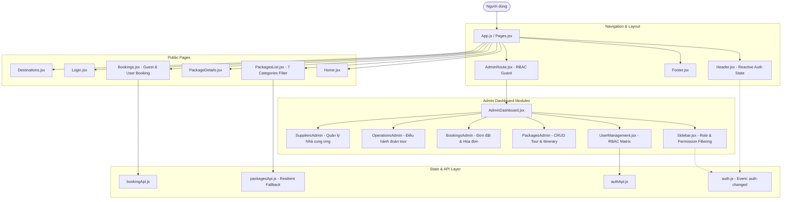
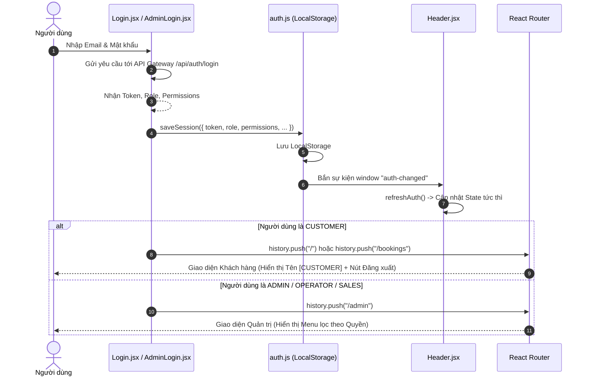
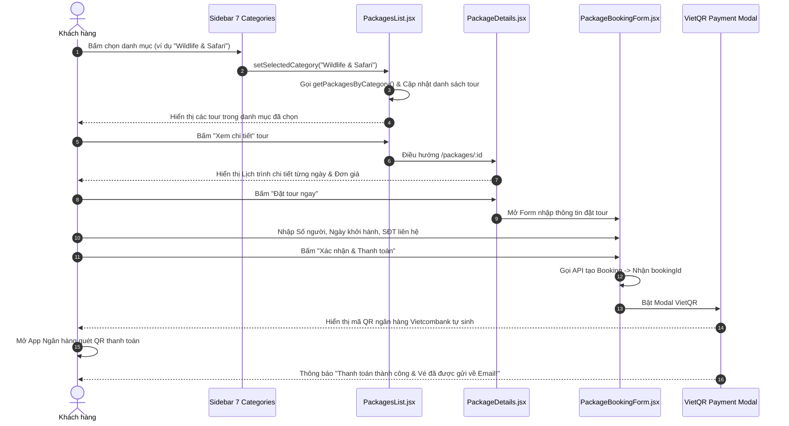
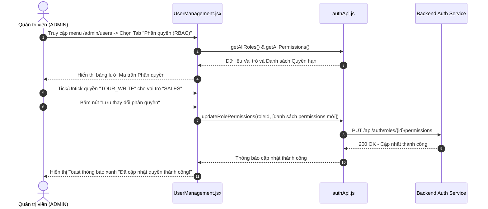

# TÀI LIỆU THIẾT KẾ CHI TIẾT FRONTEND (FRONTEND DESIGN DOCUMENT)
**Hệ thống Quản lý và Điều hành Tour Du lịch TravelBook**
**Công nghệ:** React 18 | React Router v5 | Vanilla CSS3 / CSS Modules | FontAwesome Icons

---

## 1. TỔNG QUAN KIẾN TRÚC FRONTEND

Frontend của TravelBook được phát triển theo mô hình **Single Page Application (SPA)** với trải nghiệm người dùng mượt mà, không giật lag chuyển trang. Giao diện được thiết kế hiện đại, responsive thích ứng trên cả máy tính (Desktop), máy tính bảng (Tablet) và điện thoại di động (Mobile).



---

## 2. CẤU TRÚC THƯ MỤC & ĐỊNH TUYẾN (ROUTING DESIGN)

### 2.1. Cấu trúc thư mục mã nguồn (`Frontend/src`)
```
Frontend/src/
├── api/                   # Tầng gọi API kết nối Microservices
│   ├── config.js          # Khai báo endpoint & cổng Gateway (8080)
│   ├── authApi.js         # API Đăng nhập, người dùng & ma trận quyền
│   ├── packagesApi.js     # API Packages & Fallback trực tiếp cổng 8084
│   ├── bookingApi.js      # API Đặt tour, thanh toán VietQR & hóa đơn
│   └── destinationApi.js  # API Điểm đến du lịch
├── components/
│   ├── common/            # Header, Footer, Heading dùng chung
│   ├── auth/              # Đăng nhập (Login.jsx), Đăng ký (Register.jsx)
│   ├── packages/          # Catalog tour, bộ lọc 7 danh mục, chi tiết tour
│   ├── destinations/      # Danh bạ điểm đến & bản đồ
│   ├── bookings/          # Form đặt tour, tra cứu booking, modal VietQR
│   └── admin/             # Phân hệ Quản trị & Điều hành
│       ├── AdminRoute.jsx # Guard bảo vệ route quản trị
│       ├── AdminLogin.jsx # Đăng nhập quản trị viên
│       ├── Sidebar.jsx    # Menu bên trái lọc theo phân quyền
│       ├── UserManagement/# Quản lý tài khoản & ma trận quyền RBAC
│       ├── PackagesAdmin/ # Thêm/sửa gói tour & lịch trình chi tiết
│       ├── BookingsAdmin/ # Quản lý đơn booking & hóa đơn VAT
│       ├── OperationsAdmin/# Điều hành xe, gán HDV
│       └── SuppliersAdmin/# Quản lý nhà cung ứng
└── utils/
    └── auth.js            # Tiện ích quản lý Session, Token, Role & Permission
```

### 2.2. Bảng định tuyến (Route Table)
| Đường dẫn (URL) | Component hiển thị | Quyền truy cập | Mục đích |
| :--- | :--- | :--- | :--- |
| `/` | `Home` | Public | Trang chủ giới thiệu, banner ưu đãi, tour nổi bật |
| `/packages` | `PackagesList` | Public | Danh mục tour với bộ lọc 7 chuyên mục du lịch |
| `/packages/:id` | `PackageDetails` | Public | Chi tiết gói tour, hành trình chi tiết từng ngày |
| `/destinations` | `Destinations` | Public | Thắng cảnh & cẩm nang du lịch Việt Nam |
| `/bookings` | `Bookings` | Public | Tiếp nhận đặt tour & tra cứu lịch sử đặt chỗ |
| `/login` | `Login` | Public | Đăng nhập tài khoản du khách & nhân viên |
| `/admin/login` | `AdminLogin` | Public | Cổng đăng nhập dành riêng cho Quản trị viên/Điều hành |
| `/admin` | `AdminDashboard` | `canAccessAdmin()` | Bảng điều khiển trung tâm quản trị |
| `/admin/packages` | `PackagesList (Admin)` | `TOUR_READ` / `WRITE` | Quản lý danh mục tour và chi tiết lịch trình |
| `/admin/destinations` | `DestinationsList` | `TOUR_WRITE` | Quản lý thắng cảnh, địa danh |
| `/admin/bookings` | `BookingsList` | `BOOKING_VIEW` / `MANAGE` | Quản lý đơn hàng, duyệt thanh toán |
| `/admin/operations` | `OperationsList` | `OPERATIONS_DISPATCH` | Điều hành xe, phân công hướng dẫn viên cho đoàn |
| `/admin/suppliers` | `SuppliersList` | `SUPPLIER_MANAGE` | Quản lý đối tác khách sạn, nhà hàng, nhà xe |
| `/admin/users` | `UserManagement` | `USER_MANAGE` / `ROLE_MANAGE` | Quản lý tài khoản và phân quyền động RBAC |

---

## 3. THIẾT KẾ COMPONENT & CLASS (COMPONENT SPECIFICATIONS)

### 3.1. Component `Header.jsx` (Reactive Authentication Header)
* **Trách nhiệm:** Hiển thị logo, thanh điều hướng chính, nhận biết trạng thái đăng nhập thời gian thực và vai trò của người dùng.
* **Cơ chế phản ứng động (Reactive State):**
  * Không lưu cứng biến cục bộ; sử dụng `useState` cho `auth` (`loggedIn`, `role`, `userName`, `canAdmin`).
  * Lắng nghe đồng thời sự kiện định tuyến `location.pathname`, sự kiện toàn cục `auth-changed` và sự kiện trình duyệt `storage`.
  * Hiển thị thẻ Role Badge màu sắc riêng (ví dụ: `[ADMIN]`, `[OPERATOR]`, `[CUSTOMER]`).
  * Nút **Đăng xuất (Logout)**: Thực hiện `clearSession()`, phát tán sự kiện `auth-changed` và làm mới trạng thái bằng `window.location.href = "/"`.

### 3.2. Component `PackagesList.jsx` (Catalog 7 Danh mục Tour)
* **Trách nhiệm:** Trình bày danh mục tour du lịch, bộ lọc tương tác bên trái theo 7 danh mục chuẩn:
  1. `Nature & Adventure`
  2. `Cultural & Historical`
  3. `Beaches & Relaxation`
  4. `Wildlife & Safari`
  5. `Spiritual & Wellness`
  6. `Luxury & Honeymoon`
  7. `Food & Culinary`
* **Tính năng:**
  * Tự động tính toán số lượng tour có sẵn cho từng danh mục (ví dụ: `Wildlife & Safari (2)`).
  * Chuyển đổi danh mục tức thì mà không cần reload trang.
  * Hiển thị trạng thái đang tải (Loading Spinner) và trạng thái rỗng (Empty State) khi danh mục chưa có tour.

### 3.3. Component `Sidebar.jsx` (Admin Dynamic RBAC Menu)
* **Trách nhiệm:** Cung cấp thanh điều hướng bên trái cho khu vực quản trị.
* **Kiểm soát hiển thị dựa trên Quyền (Permission-Based Rendering):**
  ```jsx
  {hasPermission("TOUR_READ") && <li ...>Packages</li>}
  {hasPermission("BOOKING_VIEW") && <li ...>Bookings</li>}
  {hasPermission("OPERATIONS_DISPATCH") && <li ...>Điều hành Tour</li>}
  {hasPermission("SUPPLIER_MANAGE") && <li ...>Nhà cung ứng</li>}
  {hasPermission("USER_MANAGE") && <li ...>Phân quyền & RBAC</li>}
  ```
  Nhân viên vai trò `SALES` sẽ không nhìn thấy mục "Điều hành Tour", nhân viên `OPERATOR` không thấy mục "Phân quyền & RBAC", đảm bảo an toàn nghiệp vụ tối đa.

### 3.4. Component `UserManagement.jsx` (Quản lý Tài khoản & Ma trận RBAC)
* **Trách nhiệm:** Cung cấp 2 Tab quản trị chuyên sâu cho Quản trị viên (`ADMIN`):
  1. **Tab Tài khoản Người dùng:** Danh sách tài khoản, đổi vai trò trực tiếp (Dropdown select) và nút Khóa/Mở khóa tài khoản (`ACTIVE` / `LOCKED`).
  2. **Tab Ma trận Phân quyền (Role-Permission Matrix):** Bảng lưới trực quan thể hiện các cột Quyền hạn (`TOUR_READ`, `BOOKING_MANAGE`...) đối chiếu với từng Vai trò (`ADMIN`, `OPERATOR`, `SALES`, `GUIDE`, `CUSTOMER`). Cho phép tick/untick checkbox và lưu cấu hình động xuống database mà không cần sửa code.

### 3.5. Component Thanh toán VietQR Modal (`PaymentModal.jsx`)
* **Trách nhiệm:** Sau khi gửi form đặt tour thành công, giao diện tự động bật popup hiển thị mã QR thanh toán chuẩn Vietcombank NAPAS247.
* **Thông tin hiển thị:** Mã QR độ nét cao, Tên chủ tài khoản, Số tài khoản ngân hàng, Số tiền thanh toán bằng chữ & số, Mã nội dung chuyển khoản tự sinh (`TB<Mã_Booking> <SĐT>`).

---

## 4. QUẢN LÝ TRẠNG THÁI & TẦNG API CLIENT (STATE & API LAYER)

### 4.1. Quản lý Phiên & Bộ nhớ đệm (`utils/auth.js`)
Lưu trữ phiên người dùng an toàn trong `LocalStorage`:
* `token`: Chuỗi JSON Web Token (JWT) dùng cho header `Authorization: Bearer <token>`.
* `userId`, `userName`, `userEmail`: Định danh thông tin cá nhân.
* `role`: Vai trò chính thức (`ADMIN`, `OPERATOR`, `SALES`, `GUIDE`, `CUSTOMER`).
* `permissions`: Mảng chuỗi các quyền hạn cụ thể (ví dụ: `["TOUR_READ", "BOOKING_VIEW"]`).
* Hàm tiện ích xác thực:
  * `isLoggedIn()`: Kiểm tra đã đăng nhập chưa.
  * `canAccessAdmin()`: Kiểm tra có phải là nhân viên nội bộ (`ADMIN`, `OPERATOR`, `SALES`) hay không.
  * `hasPermission(permissionName)`: Kiểm tra quyền cụ thể, `ADMIN` tự động bypass kiểm tra.

### 4.2. Kiến trúc Chống sập API (Resilient Fallback Architecture)
Trong `packagesApi.js` và `adminApi.js`, hệ thống triển khai cơ chế tự động thử lại (Fallback):
```javascript
const safeFetchJson = async (primaryUrl, fallbackUrl) => {
  try {
    const res = await fetch(primaryUrl); // Gọi qua Gateway :8080
    if (res.ok) return await res.json();
  } catch (err) {
    console.warn(`Gateway fetch failed for ${primaryUrl}, trying fallback...`);
  }
  if (fallbackUrl) {
    const res = await fetch(fallbackUrl); // Gọi trực tiếp Microservice :8084
    if (res.ok) return await res.json();
  }
  return null;
};
```
Nhờ cơ chế này, nếu API Gateway gặp sự cố quá tải, giao diện vẫn có thể kết nối thẳng tới dịch vụ gói tour trên cổng 8084, duy trì tính sẵn sàng cao cho du khách.

---

## 5. THIẾT KẾ PROCESSING FLOW TRÊN GIAO DIỆN (UI FLOWS)

### 5.1. Luồng Người dùng Đăng nhập & Điều hướng Phân quyền (Login & RBAC Flow)



### 5.2. Luồng Duyệt Tour & Đặt chỗ Thanh toán VietQR (Tour Booking & Payment Flow)



### 5.3. Luồng Quản trị viên Cập nhật Ma trận Phân quyền (RBAC Matrix Update Flow)


